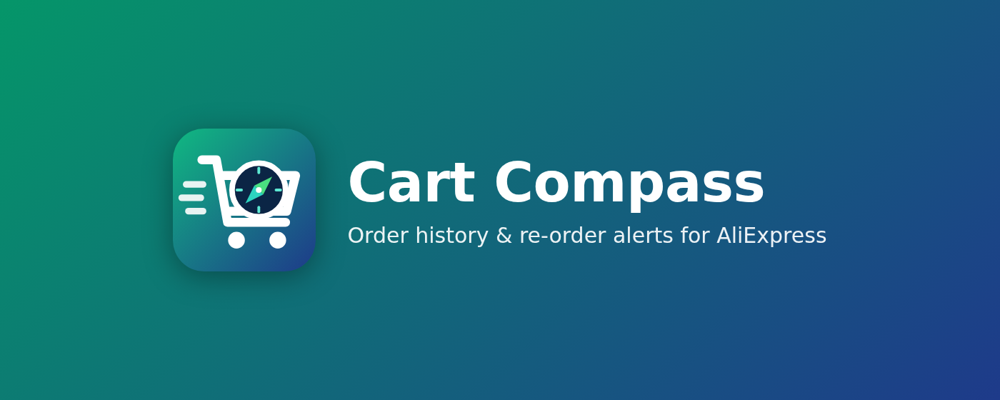
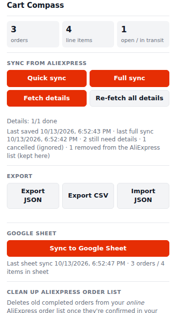
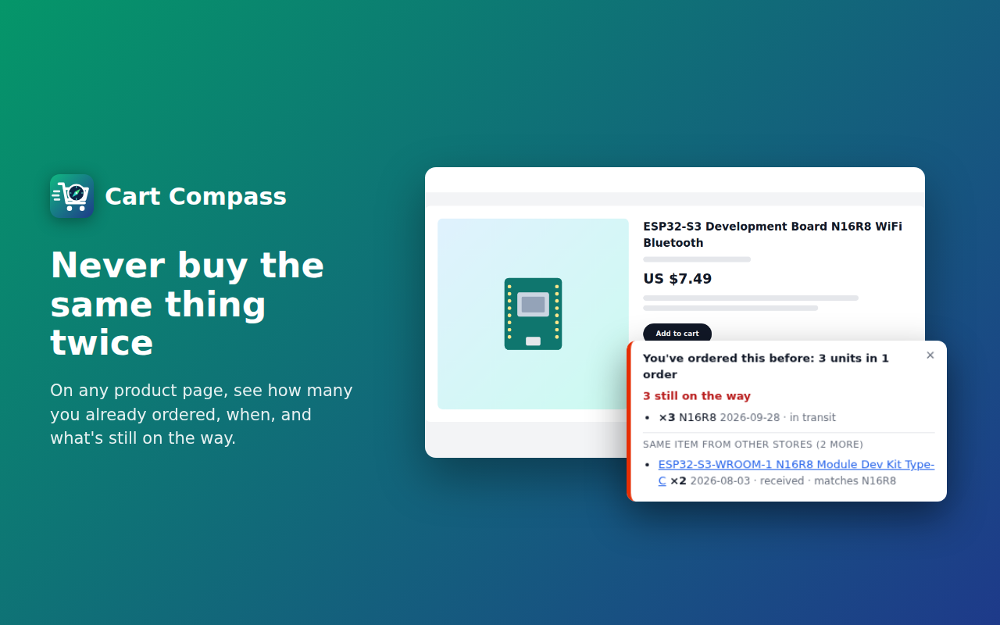
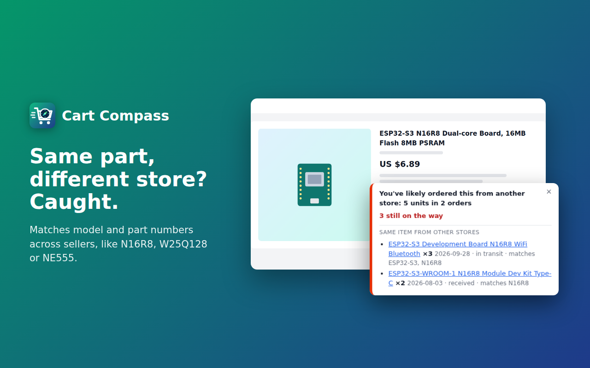
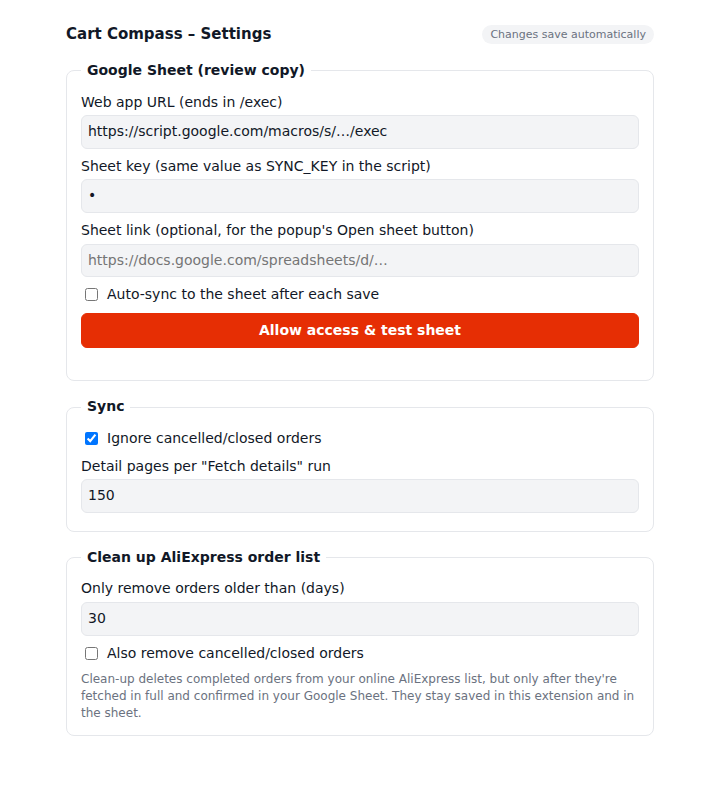

<p align="center"></p>

# Cart Compass

**Order history & re-order alerts for AliExpress.**

A free, open-source Chrome extension that keeps a **complete, local record of your AliExpress orders**: every item, variant, quantity, price, shipping charge, tax and tracking number. It can mirror that record to a **Google Sheet** and export it as **JSON or CSV**. On AliExpress itself, it **warns you before you order something you've already bought**.

Everything runs in your own browser, signed in to your own AliExpress account. There's no server, account, or tracking.

<p align="center"><a href="https://chromewebstore.google.com/detail/idfkjmeajgiodejoclmlmenkgeooiedo"><b>➜ Get Cart Compass from the Chrome Web Store</b></a> · <a href="../../wiki"><b>📖 User guide (wiki)</b></a></p>



> **Unofficial.** This project is not affiliated with, endorsed by, or connected to AliExpress or Alibaba Group. It only reads pages you can already see while signed in.

## What's new

<!-- whats-new:start -->
**v1.1.0** · 2026-10-16 · [release notes](../../releases/tag/v1.1.0)

- Expired orders are flagged
- Refund tracking
- Clean-up includes cancelled and expired orders
- Automatic local backup
- Clean-up is quicker to use
- Clean-up reads the orders page directly
- "Ref. Number" order cards are recognised
- "Refund complete" counts as a finished refund

Earlier: v1.0.0, v0.8.0, v0.7.0, … · [full changelog](CHANGELOG.md) · [all releases](../../releases)
<!-- whats-new:end -->

---

## Features

| | |
|---|---|
| 🧾 **Full order history** | Reads your *My Orders* page, loading every order with "View orders" until it reaches the end, and saves it locally. |
| 🔎 **Order details** | Opens each order's detail page in a background tab to collect full titles, unit prices, subtotal, shipping, tax ("Additional charges"), discounts and coupons, and tracking numbers. |
| 💵 **Real cost per unit** | Works out a *landed unit cost* for each item (price plus its share of shipping and tax, minus discounts) and flags orders whose numbers don't add up (`totalsCheck`). |
| 🚫 **Cancelled orders ignored** | Closed or cancelled orders are kept out of exports, the sheet and re-order warnings. You can turn this off. |
| ⚠️ **Expired orders flagged** | Orders AliExpress cancelled because the seller never shipped are listed in the popup with their refund status, so you can re-order. |
| 🔁 **Re-order warnings** | On product, cart and checkout pages: *"You've ordered this before: 6 units in 2 orders, 2 still on the way"*. It also catches the **same part from a different store** by matching model/part numbers (*N16R8*, *W25Q128*, *NE555*…), and lists similar items you've bought. |
| 🧹 **Order list clean-up** | Deletes old completed orders from your online AliExpress list once they're safely recorded in your Google Sheet, and cancelled orders once their refund is complete, so the list and every sync stay short. The extension keeps them for re-order warnings. |
| 📊 **Google Sheet sync** | A small Apps Script turns any Google Sheet into a live copy, with Orders, Items (with thumbnails and a times-ordered counter) and Sync log tabs. |
| 📤 **Export / import** | JSON and CSV, one row per item, with order totals on every row. |
| 📬 **Gmail backfill** *(optional)* | An Apps Script that builds a starter order list from your AliExpress emails. |
| ⌨️ **No-install exporter** | A snippet you paste into the DevTools console on your orders page. |

<p align="center">
  
  
</p>

---

## Install

### From the Chrome Web Store
Open **[Cart Compass on the Chrome Web Store](https://chromewebstore.google.com/detail/idfkjmeajgiodejoclmlmenkgeooiedo)** and click **Add to Chrome**. Then pin it: click the puzzle-piece icon in the toolbar and the pin next to Cart Compass. Updates install automatically.

### From a release (manual install)
1. Download `cart-compass-vX.Y.Z.zip` from the [Releases](../../releases) page and unzip it.
2. Open `chrome://extensions` and turn on **Developer mode** (top right).
3. Click **Load unpacked** and select the unzipped folder.
4. Pin **Cart Compass** to your toolbar.

### From source
```bash
git clone https://github.com/jkomilanowicz-lab/Cart-Compass.git
cd Cart-Compass
```
Then use **Load unpacked** on the `extension/` folder. To update later, run `git pull` and click the reload icon on the extension's card in `chrome://extensions`.

Works in Chrome, Edge, Brave and other Chromium browsers.

---

## Using it

1. **Sign in to AliExpress** and open **My Orders** (<https://www.aliexpress.com/p/order/index.html>). Orders already on screen are saved automatically.
2. Click the extension icon, then **Full sync**. Leave the tab open until the toast says *Done*. It clicks "View orders" until your whole history is loaded.
3. Click **Fetch details**. Each order's detail page opens briefly in a background tab, a few seconds apart. Click it again until *still need details* reaches 0. Use **Re-fetch all details** to refresh everything later.
4. Use **Export JSON / CSV**, or set up the Google Sheet (below) and click **Sync to Google Sheet**.

Later on, **Quick sync** picks up new orders and stops as soon as it reaches orders it already has.

### Popup buttons

| Button | What it does |
|---|---|
| Quick sync | Loads orders until a batch has nothing new. |
| Full sync | Loads every order. |
| Fetch details | Visits detail pages for orders missing details (or still in transit). |
| Re-fetch all details | Visits every order's detail page again, least recently fetched first. |
| Export JSON / CSV | Downloads your orders. Cancelled orders are left out by default. |
| Import JSON | Merges a previous export or a Gmail backfill file. |
| Sync to Google Sheet | Pushes everything to your sheet. |
| Open sheet | Opens your Google Sheet (when its link is set in Settings). |
| Find orders to remove → Remove N orders | Cleans up your online AliExpress order list (see below). The first time, **Remove 1 (test)** comes first. |
| ⚠ Expired: Re-order / View order / Done | Shown when an order was never shipped (see below). |
| ⚙ Settings | Google Sheet details, *Ignore cancelled orders*, detail pages per run, and clean-up options (minimum age, cancelled orders, refund wait). |
| Troubleshooting → Copy page sample | Copies an outline of the current AliExpress page for bug reports. |
| Troubleshooting → Restore automatic backup | Brings back your saved orders from the automatic backup. |
| Troubleshooting → Clear local data | Deletes the orders saved in this browser (an automatic backup is kept first). |

---

## Google Sheet sync

Optional, but recommended: the sheet is a backup you can read, and clean-up uses it to confirm an order is recorded before removing it from AliExpress. Setup takes about 5 minutes. The **[step-by-step guide](tools/google-sheet-sync/README.md)** covers each click, the sync key, Google's authorization screens and troubleshooting. In short:

1. Create a Google Sheet. Open **Extensions → Apps Script**, replace the code with [`tools/google-sheet-sync/Code.gs`](tools/google-sheet-sync/Code.gs), and save.
2. Set your **sync key**: replace `change-me-to-a-long-random-string` in `SYNC_KEY` at the top of the script with a long random string (or add it as a Script property named `SYNC_KEY`). This is the password between the extension and your sheet.
3. Optional: choose **setupSheets** in the function dropdown and click **Run** to create the tabs now.
4. **Deploy → New deployment → Web app**, with *Execute as: Me* and *Who has access: Anyone*. Authorize it. Google warns that it "hasn't verified this app" because it's your own script: click **Advanced → Go to … (unsafe)**. Copy the URL that ends in `/exec`.
5. In the extension, open **⚙ Settings** and paste the URL and the same key. Click **Allow access & test sheet** and allow access to `script.google.com`, then click **Sync to Google Sheet** in the popup.



"Anyone" lets the extension reach the URL. The `SYNC_KEY` check is what stops anyone else from writing to your sheet. The key is stored only in your browser, shown masked, and never included in exports. If you later paste a newer `Code.gs`, deploy it as a **new version** (Deploy → Manage deployments → Edit → New version), or the URL keeps running the old code.

**Tabs:**
- **Orders:** status, store, item count, units, items subtotal, subtotal, shipping, tax, discount, total, `totalsCheck` (ok/mismatch), tracking, link.
- **Items:** thumbnail, title, variant, quantity, unit price, line total, landed unit cost, product ID, `timesOrdered` (anything above 1 is a re-order).
- **Sync log:** one row per sync.

---

## Cleaning up your AliExpress order list

After a few hundred orders, *My Orders* takes many "View orders" clicks to load. The clean-up deletes old orders from that **online list** after the extension has safely recorded them. Nothing is deleted from the extension or your Google Sheet, so re-order warnings keep counting those orders.

1. In the popup, click **Find orders to remove**. It syncs the Google Sheet first, then asks the sheet which orders it really has.
2. A **completed** order is only offered for removal when **all** of these hold:
   - it's older than the minimum age (Settings, default **30 days**);
   - its detail page has been fetched;
   - the Google Sheet has it with the same status and number of items.

   A **cancelled or expired** order is offered once its refund has cleared: either the refund shows on its order page, or the refund wait has passed since it closed (Settings, default **14 days**). Unpaid orders go right away. You can turn this off in Settings.

   Clean-up also checks the orders page itself: any cancelled order whose card says **Refund complete** is removed, even one Cart Compass hadn't synced yet (it's saved first). When it's done, the status line says how many order cards it checked and lists any cancelled orders still waiting on their refund.
3. The first time, click **Remove 1 (test)**: the first eligible order found is deleted on the orders page. Check the AliExpress tab. After that the test isn't asked for again.
4. Click **Remove N orders**. Keep the AliExpress tab open; you can close the popup and reopen it, and it picks up where it left off. It stops after 3 failures in a row.

> **AliExpress can't undo a delete.** Every order removed is already in your Google Sheet, and Cart Compass keeps an automatic local backup (**Troubleshooting → Restore automatic backup**). If clean-up can't find the delete button (AliExpress changed its page), it removes nothing. Use **Troubleshooting → Copy page sample** and open an issue.

If you set up the sheet with an older `Code.gs`, paste the new one and deploy a **new version** first.

---

## Expired orders (never shipped)

When a seller doesn't ship in time, AliExpress cancels the order ("has not shipped in the required time"). Nothing is coming, but it's easy to miss. Cart Compass flags these:

- **In the popup**, under **⚠ Expired: never shipped**, with the refund status (*refunded $4.86 Oct 11*, or *refund expected by Oct 29*). **Re-order** opens the product, **View order** opens the order, and **Done** hides it once you've dealt with it.
- **On the product page**, the panel says *"Never shipped: your order of ×1 on 2026-10-02 expired"*, so you know you still don't have it.

**Fetch details** reads each closed order's page once to see why it closed, then re-checks every few days until its refund shows up.

---

## Gmail backfill (optional)

AliExpress emails carry less detail than the website: titles are cut short, and a "23 orders confirmed" email only lists the first few orders. They're still a handy starting point.

1. Go to <https://script.google.com>, create a **New project**, and paste in [`tools/gmail-apps-script/Code.gs`](tools/gmail-apps-script/Code.gs).
2. Run `exportAliExpressOrders` and authorize it. A JSON file appears in your Google Drive.
3. In the extension, click **Import JSON**. The next website sync fills in the missing details.

## Console exporter (no install)

Open your orders page, then DevTools → Console. Paste the contents of [`tools/console-export.js`](tools/console-export.js) and press Enter. It downloads JSON and CSV.

---

## Data format

See [`docs/DATA-FORMAT.md`](docs/DATA-FORMAT.md) for every field in the JSON/CSV exports and the sheet, including how *landed unit cost* and `totalsCheck` are calculated.

## Privacy

Your data never leaves your machine unless you send it somewhere: an export file, or your own Google Sheet. See [PRIVACY.md](PRIVACY.md).

## When AliExpress changes its pages

AliExpress redesigns its pages from time to time, so a field may stop being read. If that happens:
1. Open the page that's wrong (the orders list, or an order's detail page with the price breakdown expanded).
2. In the popup, open **Troubleshooting** and click **Copy page sample**. This copies a stripped-down outline of the page, with addresses and phone numbers removed. Skim it before sharing.
3. [Open an issue](../../issues/new?template=page-changed.md) and paste the sample.

All CSS selectors are in `SELECTORS` at the top of [`extension/lib/parsers.js`](extension/lib/parsers.js). Pull requests are welcome; see [CONTRIBUTING.md](CONTRIBUTING.md).

## Development

```bash
npm install
npm test        # unit tests: parsers, emails, merging, Google Sheet script
npm run build   # rebuild tools/console-export.js and tools/gmail-apps-script/Code.gs
npm run e2e     # loads the real extension in Chromium against fixture pages (needs Playwright)
npm run package # zip the extension folder for the Chrome Web Store
```

## Author

Created and maintained by [@jkomilanowicz-lab](https://github.com/jkomilanowicz-lab).

## License

[MIT](LICENSE)
